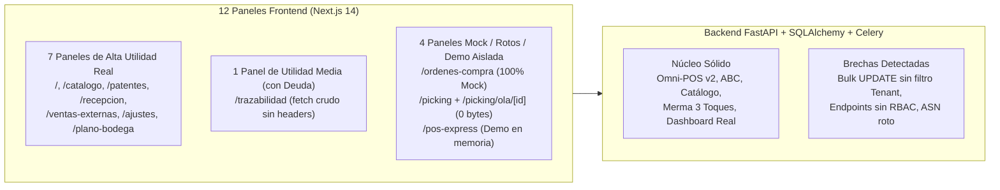

# Auditoría Integral de Código, Utilidad por Panel, Riesgos y Limpieza — SG-BVC (WMS v2.0)

> [!IMPORTANT]
> **Alcance de la Auditoría**: Se inspeccionó el **100% del repositorio** (~8.180 líneas en Backend Python/FastAPI/SQLAlchemy/Celery, ~12.400 líneas en Frontend Next.js 14/TypeScript distribuidas en **12 paneles de ruta**, 18 componentes, 2 hooks y `api.ts`, además de las 8 suites de pruebas en `tests/`).

---

## 1. Resumen Ejecutivo y Matriz Cuantitativa

| Categoría de Hallazgo | Críticos | Altos | Medios | Bajos / Higiene | Total |
| :--- | :---: | :---: | :---: | :---: | :---: |
| **1. Riesgos (Seguridad Multi-Tenant, RBAC, FEFO y Bugs Latentes)** | 4 | 5 | 5 | — | **14** |
| **2. Elementos a Eliminar (Código Basura, Huérfanos y Artefactos)** | 1 *(Ruta rota 0 bytes)* | 4 | 6 | 6 | **17** |
| **3. Estructuras Innecesarias (Duplicación, Routers Gordos, Monolitos)** | — | 3 | 5 | 2 | **10** |
| **4. Optimizaciones y Mejoras (SQL/N+1, Caché Redis, Frontend 2D, UX)** | — | 3 | 6 | 4 | **13** |
| **Total de Hallazgos Caracterizados** | **5** | **15** | **22** | **12** | **54** |



---

## 2. Evaluación de Utilidad Real Panel por Panel (Todos los Paneles)

A continuación se evalúan los **12 paneles de ruta** en `frontend/src/app/` y el modal transversal de Onboarding según su **utilidad real en producción**, conexión con el backend, riesgos y código innecesario:

| # | Panel / Ruta | Archivo y Tamaño | Utilidad Real | Estado Funcional y Diagnóstico | Acción Recomendada |
| :-: | :--- | :--- | :---: | :--- | :--- |
| **1** | **Centro de Control Operativo** (`/`) | [`frontend/src/app/page.tsx`](file:///c:/Users/Acer/OneDrive/Desktop/BVCore%20-%20Proyecto/frontend/src/app/page.tsx) (399 L) | **ALTA (Crítico)** | Conectado 100% a datos reales (`GET /api/v1/dashboard/kpis`). Muestra salud de inventario, riesgo FEFO valorizado en CLP, merma vs ventas 30d, alertas accionables con links directos y desempeño mensual real. | **Conservar**. Eliminar los 4 archivos antiguos huérfanos en `components/dashboard/*` y `useDashboardMetrics.ts` que quedaron sin uso tras este rediseño. |
| **2** | **Catálogo Maestro + PLU** (`/catalogo`) | [`frontend/src/app/catalogo/page.tsx`](file:///c:/Users/Acer/OneDrive/Desktop/BVCore%20-%20Proyecto/frontend/src/app/catalogo/page.tsx) (1.569 L) + [`CatalogTable.tsx`](file:///c:/Users/Acer/OneDrive/Desktop/BVCore%20-%20Proyecto/frontend/src/components/catalogo/CatalogTable.tsx) (491 L) | **ALTA (Crítico)** | CRUD completo, importación CSV/TXT/JSON, ingreso rápido de lotes, ajuste de stock por lote, generador de códigos internos `PLU-XXXX` / EAN-13 prefijo `200` e impresión de etiquetas. | **Conservar y Modularizar**. Extraer los 5 modales embebidos en `catalogo/page.tsx` a subcomponentes en `components/catalogo/`. |
| **3** | **Plano de Supermercado 2D** (`/patentes`) | [`frontend/src/app/patentes/page.tsx`](file:///c:/Users/Acer/OneDrive/Desktop/BVCore%20-%20Proyecto/frontend/src/app/patentes/page.tsx) (3.225 L) | **ALTA (Core Diferenciador)** | Gemelo Digital 2D con 4 capas térmicas (`categorias`, `stock`, `vencimientos`, `abc`), micro-slotting en grilla, abastecimiento bodega $\rightarrow$ vitrina, conteo cíclico y borrador local por tenant. | **Conservar, Corregir Bug Tenant y Dividir**. Es un monolito de 3.225 líneas; además contiene una sección de **Decoraciones de Plano** en backend/API que ya no se usa en el lienzo. |
| **4** | **Recepción y Abastecimiento** (`/recepcion`) | [`frontend/src/app/recepcion/page.tsx`](file:///c:/Users/Acer/OneDrive/Desktop/BVCore%20-%20Proyecto/frontend/src/app/recepcion/page.tsx) (636 L) | **ALTA (Crítico)** | Flujo unificado de 3 pasos: (1) Recepción en puerta GS1-128/DUN-14/EAN con validación de cadena de frío y vida útil, (2) Fraccionamiento de cajas y (3) Abastecimiento a góndola con offline sync. | **Conservar**. Corregir clave `localStorage` en [`useOfflineSync.ts`](file:///c:/Users/Acer/OneDrive/Desktop/BVCore%20-%20Proyecto/frontend/src/hooks/useOfflineSync.ts#L15) para incluir `tenant_id`. |
| **5** | **Integración POS & Ventas** (`/ventas-externas`) | [`frontend/src/app/ventas-externas/page.tsx`](file:///c:/Users/Acer/OneDrive/Desktop/BVCore%20-%20Proyecto/frontend/src/app/ventas-externas/page.tsx) (1.376 L) | **ALTA (Crítico)** | Hub Omni-POS v2 con vista adaptativa (`FILE_BATCH` vs `WEBHOOK_API`), Dry-Run pre-vuelo, creación rápida de productos en caliente, Bandeja de Cuarentena de Huérfanos e Inspector de Boleta con Reversión FEFO. | **Conservar y Modularizar**. Extraer el Inspector de Boleta y la Bandeja de Cuarentena en subcomponentes dedicados. |
| **6** | **Merma Rápida y Ajustes** (`/ajustes`) | [`frontend/src/app/ajustes/page.tsx`](file:///c:/Users/Acer/OneDrive/Desktop/BVCore%20-%20Proyecto/frontend/src/app/ajustes/page.tsx) (878 L) | **ALTA (Crítico)** | Merma Rápida en 3 Toques (RF-01) con descuento FEFO automático, valorización en CLP, historial auditable y pestaña secundaria para ajuste de recepción de pallets LPN. | **Conservar**. Deprecar gradualmente el endpoint antiguo `POST /merma/declarar` en favor de `POST /merma/rapida`. |
| **7** | **Mapa Virtual de Bodega** (`/plano-bodega`) | [`frontend/src/app/plano-bodega/page.tsx`](file:///c:/Users/Acer/OneDrive/Desktop/BVCore%20-%20Proyecto/frontend/src/app/plano-bodega/page.tsx) (233 L) | **MEDIA-ALTA** | Visualiza zonas de trastienda (`BODEGA_SECOS`, `CAMARA_FRIO`, `CAMARA_CONGELADOS`) y permite drill-down de lotes ordenados por prioridad FEFO. Sin embargo, **no permite crear ni editar zonas desde la UI** (solo lectura). | **Mejorar o Fusionar**. Agregar botón para crear/editar zonas de bodega (`tipo_ubicacion != SALA_VENTA`) o integrarlo como pestaña "Trastienda / Bodega" dentro de `/patentes`. |
| **8** | **Trazabilidad / Movimientos** (`/trazabilidad`) | [`frontend/src/app/trazabilidad/page.tsx`](file:///c:/Users/Acer/OneDrive/Desktop/BVCore%20-%20Proyecto/frontend/src/app/trazabilidad/page.tsx) (372 L) | **MEDIA (Con Bugs)** | Consulta `Log_Transaccional` y visualiza el árbol genealógico Padre $\rightarrow$ Hijo de SATOs. **Problema grave**: usa `fetch("http://localhost:8000/logs...")` crudo sin `X-Tenant-ID` ni `Authorization`, y filtra por nombres de acción obsoletos (`VENTA_CAJA`, `FRACCIONAMIENTO`). | **Refactorizar Urgente**. Conectar mediante `fetchWithResilience` en `api.ts` y actualizar el catálogo de acciones reales (`VENTA_EXTERNA_POS`, `DECLARACION_MERMA`, etc.). |
| **9** | **Órdenes de Compra** (`/ordenes-compra`) | [`frontend/src/app/ordenes-compra/page.tsx`](file:///c:/Users/Acer/OneDrive/Desktop/BVCore%20-%20Proyecto/frontend/src/app/ordenes-compra/page.tsx) (60 L) + [`OrdersTable.tsx`](file:///c:/Users/Acer/OneDrive/Desktop/BVCore%20-%20Proyecto/frontend/src/components/ordenes-compra/OrdersTable.tsx) (59 L) + [`UploadOrderModal.tsx`](file:///c:/Users/Acer/OneDrive/Desktop/BVCore%20-%20Proyecto/frontend/src/components/ordenes-compra/UploadOrderModal.tsx) (51 L) | **NULA (100% Mock Estático)** | **Cero conexión con el backend**. Renderiza 4 órdenes estáticas hardcodeadas (`OC-2026-001` de `Soprole S.A.`, `Agrosuper`, etc.). Los filtros de búsqueda/proveedor y los botones `"Vista Previa"`, `"Árbol"`, `"Subir Documento"` y `"Escribir a Mano"` no tienen ningún handler `onClick`. | **Eliminar de Sidebar o Conectar a ASN**. Mientras no exista un CRUD real de órdenes de compra, ocultarlo del Sidebar (actualmente visible en modo avanzado) o eliminar el módulo mock. |
| **10** | **Preparación de Pedidos / Olas** (`/picking`) | [`frontend/src/app/picking/page.tsx`](file:///c:/Users/Acer/OneDrive/Desktop/BVCore%20-%20Proyecto/frontend/src/app/picking/page.tsx) (89 L) | **ROTO / INCOMPLETO** | Lista olas desde `GET /outbound/waves`, pero **no existe ningún panel ni botón en el sistema para crear `Pedido_Outbound` ni generar olas** (`POST /outbound/waves/generar`). Además, el botón `"Iniciar Picking"` enlaza a `/picking/ola/${ola.id}`, que es un archivo vacío de 0 bytes. | **Eliminar o Completar**. Para minimarkets y supermercados de sala, el flujo de salida es Omni-POS (`/ventas-externas`). Si no se usa picking e-commerce/B2B, eliminar `/picking` y `outbound.py`. |
| **11** | **Ejecución de Ola de Picking** (`/picking/ola/[ola_id]`) | [`frontend/src/app/picking/ola/[ola_id]/page.tsx`](file:///c:/Users/Acer/OneDrive/Desktop/BVCore%20-%20Proyecto/frontend/src/app/picking/ola/%5Bola_id%5D/page.tsx) (**0 L / 0 bytes**) | **ROTO (Crash Next.js)** | Archivo completamente vacío (**0 bytes**). Navegar a `/picking/ola/1` lanza error fatal en Next.js (`The default export is not a React Component`). | **Eliminar directorio `/picking/ola/` inmediatamente**. |
| **12** | **POS Express Don Pedro** (`/pos-express`) | [`frontend/src/app/pos-express/page.tsx`](file:///c:/Users/Acer/OneDrive/Desktop/BVCore%20-%20Proyecto/frontend/src/app/pos-express/page.tsx) (1.221 L) | **DEMO AISLADA** | Opera 100% en memoria local (`CATALOGO_DEMO` hardcodeado) con simulación de cobro Efectivo/Transbank sin llamar al backend. Ya está oculto del Sidebar como demo según decisión de arquitectura (Invariante 2.1: SG-BVC no tiene POS de caja propio). | **Mantener oculto como Demo o Archivar** fuera del bundle productivo si se desea reducir el peso de compilación de Next.js. |
| **—** | **Asistente de Puesta en Marcha** (Modal Global) | [`OnboardingWizardModal.tsx`](file:///c:/Users/Acer/OneDrive/Desktop/BVCore%20-%20Proyecto/frontend/src/components/onboarding/OnboardingWizardModal.tsx) (537 L) | **ALTA** | Configura rubro (`MINIMARKET` / `SUPERMERCADO`), estrategia POS (`FILE_BATCH` / `WEBHOOK_API`) y aplica plantillas de plano 2D idempotentes en < 3 minutos. | **Conservar**. |

---

## 3. Riesgos Detectados (Seguridad Multi-Tenant, RBAC, FEFO y Bugs)

### 3.1 Riesgos Críticos (Prioridad Inmediata)

> [!CAUTION]
> Los siguientes 4 hallazgos representan riesgos de **corrupción de datos entre tenants**, **ejecución no autenticada de mutaciones** o **fallo determinista de endpoints en producción**.

1. **[CRÍTICO-01] Corrupción Cross-Tenant en `.update()` y `.delete()` Masivos (Bypass del Hook ORM)**
   - **Ubicación**: [`_add_tenant_filter`](file:///c:/Users/Acer/OneDrive/Desktop/BVCore%20-%20Proyecto/app/database.py#L211-L223) y [`eliminar_patente`](file:///c:/Users/Acer/OneDrive/Desktop/BVCore%20-%20Proyecto/app/domains/wms/routers/patente.py#L226-L229).
   - **Causa**: El listener `@event.listens_for(Session, "do_orm_execute")` en [`app/database.py:214`](file:///c:/Users/Acer/OneDrive/Desktop/BVCore%20-%20Proyecto/app/database.py#L214) solo intercepta `if tenant_id and execute_state.is_select:`. En SQLAlchemy 2.0, las operaciones `query.update(...)` y `query.delete(...)` tienen `is_update=True` / `is_delete=True` (`is_select=False`), por lo que **`with_loader_criteria` NO se aplica a ningún `.update()` ni `.delete()` masivo**.
   - **Impacto Real**: En [`app/domains/wms/routers/patente.py:226-229`](file:///c:/Users/Acer/OneDrive/Desktop/BVCore%20-%20Proyecto/app/domains/wms/routers/patente.py#L226-L229):
     ```python
     db.query(Sato).filter(Sato.ubicacion_id == id_patente).update(
         {"ubicacion_id": None, "nivel_estante": None, "frente_posicion": None},
         synchronize_session=False,
     )
     ```
     Si el Tenant A elimina su góndola `"GOND-01"`, este `UPDATE` sin `Sato.tenant_id == tenant_id` **desvincula y borra las coordenadas de todos los lotes `Sato` ubicados en `"GOND-01"` de TODOS los demás tenants del sistema**.
   - **Remediación**: Agregar explícitamente `Sato.tenant_id == current_tenant_id.get()` en `patente.py:226` e interceptar también `execute_state.is_update or execute_state.is_delete` con criterios `where()` en `_add_tenant_filter`.

2. **[CRÍTICO-02] Autenticación Desactivada por Defecto (`AUTH_REQUIRED=False`) y Endpoints Mutadores sin RBAC ni Auth**
   - **Ubicación**: [`Settings.AUTH_REQUIRED`](file:///c:/Users/Acer/OneDrive/Desktop/BVCore%20-%20Proyecto/app/core/config.py#L28), [`get_current_user`](file:///c:/Users/Acer/OneDrive/Desktop/BVCore%20-%20Proyecto/app/core/security.py#L73-L80), [`require_role`](file:///c:/Users/Acer/OneDrive/Desktop/BVCore%20-%20Proyecto/app/core/security.py#L118-L121).
   - **Causa**:
     1. `AUTH_REQUIRED` tiene valor por defecto `False`. Cuando es `False`, `get_current_user` retorna `None` y `require_role` permite el paso irrestricto (`if user is None: return None`).
     2. Peor aún: **incluso activando `AUTH_REQUIRED=True`**, los siguientes endpoints omitieron por completo `Depends(get_current_user)` o `Depends(require_role(...))`:
        - `POST /asn/inyeccion` ([`app/domains/integration/routers/asn.py:20`](file:///c:/Users/Acer/OneDrive/Desktop/BVCore%20-%20Proyecto/app/domains/integration/routers/asn.py#L20)): **inyecta ASNs y crea productos Ghost SKU en la BD sin token JWT ni `X-API-Key`**.
        - `GET /bodega/recepcion/satos` ([`app/domains/wms/routers/bodega.py:39`](file:///c:/Users/Acer/OneDrive/Desktop/BVCore%20-%20Proyecto/app/domains/wms/routers/bodega.py#L39)): expone lotes en recepción sin autenticación.
        - `GET /api/v1/mapa/bodega/` y `GET /api/v1/mapa/bodega/{id_patente}/stock` ([`app/domains/wms/routers/mapa_bodega.py:35, 90`](file:///c:/Users/Acer/OneDrive/Desktop/BVCore%20-%20Proyecto/app/domains/wms/routers/mapa_bodega.py#L35)): exponen mapa y stock de bodega sin autenticación.
        - `GET /outbound/waves` y `GET /outbound/waves/{ola_id}/tareas` ([`app/domains/integration/routers/outbound.py:14, 28`](file:///c:/Users/Acer/OneDrive/Desktop/BVCore%20-%20Proyecto/app/domains/integration/routers/outbound.py#L14)): sin autenticación.

3. **[CRÍTICO-03] Crash Garantizado (`TypeError`) en `POST /api/v1/integration/asn` por Desfase con Modelo ORM**
   - **Ubicación**: [`procesar_asn_inbound`](file:///c:/Users/Acer/OneDrive/Desktop/BVCore%20-%20Proyecto/app/services/integration_service.py#L228-L272) invocado desde [`recibir_asn_erp`](file:///c:/Users/Acer/OneDrive/Desktop/BVCore%20-%20Proyecto/app/domains/integration/routers/integration.py#L75-L108).
   - **Causa**: `procesar_asn_inbound` instancia `ASN_Padre(proveedor=..., fecha_recepcion_esperada=..., estado="PENDIENTE")` y `ASN_Detalle(asn_id=nuevo_asn.id, sku=..., cantidad_esperada=..., cantidad_recibida=0)`. Ninguna de esas columnas existe en [`ASN_Padre`](file:///c:/Users/Acer/OneDrive/Desktop/BVCore%20-%20Proyecto/app/models.py#L170-L176) (`tenant_id`, `lpn`, `origen`, `estado`) ni en [`ASN_Detalle`](file:///c:/Users/Acer/OneDrive/Desktop/BVCore%20-%20Proyecto/app/models.py#L177-L189) (`tenant_id`, `id`, `lpn_padre`, `sku`, `cantidad`, `lote`, `fecha_vencimiento`).
   - **Impacto**: Cualquier llamada al endpoint oficial M2M `POST /api/v1/integration/asn` falla el 100% de las veces con `HTTP 400: TypeError: 'proveedor' is an invalid keyword argument for ASN_Padre`.

4. **[CRÍTICO-04] Clave Primaria Global sin `tenant_id` en `ASN_Padre` (`lpn`)**
   - **Ubicación**: [`ASN_Padre`](file:///c:/Users/Acer/OneDrive/Desktop/BVCore%20-%20Proyecto/app/models.py#L170-L176) y [`ASN_Detalle`](file:///c:/Users/Acer/OneDrive/Desktop/BVCore%20-%20Proyecto/app/models.py#L177-L189).
   - **Causa**: A diferencia de `Catalogo_Producto` (`primary_key=(tenant_id, sku)`) y `Patente` (`primary_key=(tenant_id, id_patente)`), `ASN_Padre` define `lpn = Column(String, primary_key=True)` como clave primaria global única en toda la tabla.
   - **Impacto**: Dos tenants distintos no pueden registrar un pallet con el mismo código LPN (ej. en pruebas o proveedores compartidos), provocando `IntegrityError` o colisión entre tenants.

---

### 3.2 Riesgos Altos

1. **[ALTO-01] `Catalogo_Producto.categoria_rel` con `lazy="joined"` Rompe `SELECT ... FOR UPDATE` en PostgreSQL (Neon)**
   - **Ubicación**: [`Catalogo_Producto.categoria_rel`](file:///c:/Users/Acer/OneDrive/Desktop/BVCore%20-%20Proyecto/app/models.py#L54).
   - **Causa**: `lazy="joined"` genera automáticamente un `LEFT OUTER JOIN categoria` en cada consulta sobre `Catalogo_Producto`. PostgreSQL prohíbe `SELECT ... FOR UPDATE` cuando hay un `LEFT OUTER JOIN` (`psycopg2.errors.FeatureNotSupported: FOR UPDATE cannot be applied to the nullable side of an outer join`).
   - **Impacto**: Ya causó un fallo real en `resolver_item_huerfano` (corregido con `.options(noload("*"))` en [`external_sales_service.py:1321`](file:///c:/Users/Acer/OneDrive/Desktop/BVCore%20-%20Proyecto/app/services/external_sales_service.py#L1321)), pero sigue siendo una trampa latente para cualquier servicio futuro que bloquee una fila de `Catalogo_Producto`. Cambiar a `lazy="selectin"` elimina el `LEFT OUTER JOIN` sin perder carga eficiente.

2. **[ALTO-02] Paso de Sesión SQLAlchemy (`db`) Cerrada a `BackgroundTasks` en Recepción y Outbound**
   - **Ubicación**: [`recepcionar_lpn`](file:///c:/Users/Acer/OneDrive/Desktop/BVCore%20-%20Proyecto/app/services/recepcion_service.py#L253) y [`registrar_faltante_tarea`](file:///c:/Users/Acer/OneDrive/Desktop/BVCore%20-%20Proyecto/app/services/outbound_service.py#L195).
   - **Causa**: Ambos llaman `background_tasks.add_task(emitir_webhook, db, ...)`. En FastAPI, `BackgroundTasks` se ejecuta **después** de enviar la respuesta HTTP, momento en el que `get_db()` ejecuta `db.close()`. Además, [`emit_event`](file:///c:/Users/Acer/OneDrive/Desktop/BVCore%20-%20Proyecto/app/services/integration_service.py#L87-L88) solo hace `db.add(log_entry); db.flush()` sin `db.commit()`, por lo que el registro en `Integration_Log` jamás se confirma en base de datos cuando se invoca desde `BackgroundTasks`.

3. **[ALTO-03] `JWT_SECRET_KEY` Efímero en `config.py`**
   - **Ubicación**: [`Settings.JWT_SECRET_KEY`](file:///c:/Users/Acer/OneDrive/Desktop/BVCore%20-%20Proyecto/app/core/config.py#L23).
   - **Causa**: `JWT_SECRET_KEY: str = secrets.token_urlsafe(32)` genera una clave aleatoria distinta en cada arranque o en cada worker de Uvicorn/Celery si no está fijada en `.env`, invalidando sesiones activas al reiniciar o balancear entre procesos.

4. **[ALTO-04] Fuga de Detalles Internos SQL (`str(e)`) en Respuestas HTTP 400**
   - **Ubicación**: [`asn.py:66, 92`](file:///c:/Users/Acer/OneDrive/Desktop/BVCore%20-%20Proyecto/app/domains/integration/routers/asn.py#L66), [`integration.py:108`](file:///c:/Users/Acer/OneDrive/Desktop/BVCore%20-%20Proyecto/app/domains/integration/routers/integration.py#L108), [`outbound.py:25, 33`](file:///c:/Users/Acer/OneDrive/Desktop/BVCore%20-%20Proyecto/app/domains/integration/routers/outbound.py#L25).
   - **Causa**: Capturan `Exception as e` y devuelven `str(e)` directamente al cliente HTTP, exponiendo sentencias SQL, nombres de tablas y parámetros internos de PostgreSQL.

5. **[ALTO-05] Panel `/trazabilidad` Ignora `X-Tenant-ID`, `Authorization` y `NEXT_PUBLIC_API_URL`**
   - **Ubicación**: [`TrazabilidadPage`](file:///c:/Users/Acer/OneDrive/Desktop/BVCore%20-%20Proyecto/frontend/src/app/trazabilidad/page.tsx#L49-L83).
   - **Causa**: Usa `fetch("http://localhost:8000/logs...")` directo en vez de `fetchWithResilience` de `api.ts`. Al no enviar `X-Tenant-ID`, consulta siempre `tenant-default` aunque el usuario esté operando en otro local/tenant, y falla con `401` si se activa `AUTH_REQUIRED=True`.

---

### 3.3 Riesgos Medios

1. **[MEDIO-01] `useOfflineSync` Comparte Cola `localStorage` entre Distintos Tenants**
   - **Ubicación**: [`useOfflineSync.ts:15, 47`](file:///c:/Users/Acer/OneDrive/Desktop/BVCore%20-%20Proyecto/frontend/src/hooks/useOfflineSync.ts#L15) e invocación en [`recepcion/page.tsx:76`](file:///c:/Users/Acer/OneDrive/Desktop/BVCore%20-%20Proyecto/frontend/src/app/recepcion/page.tsx#L76) (`useOfflineSync('bvc_offline_vitrina_moves', ...)`).
   - **Impacto**: La clave de `localStorage` no incluye `getActiveTenantId()` (a diferencia del borrador 2D en `patentes/page.tsx:235`). Si un navegador cambia de tenant mientras hay movimientos offline encolados, los reenviará bajo el nuevo tenant al recuperar conexión.

2. **[MEDIO-02] Orden FEFO No Determinista y `skip_locked=True` Silencioso en `generar_ola_picking`**
   - **Ubicación**: [`generar_ola_picking`](file:///c:/Users/Acer/OneDrive/Desktop/BVCore%20-%20Proyecto/app/services/outbound_service.py#L34-L42).
   - **Causa**: Ordena por `(Sato.fecha_vencimiento.asc().nulls_last(), Sato.cantidad.desc())` sin desempatar por `Sato.sato_id.asc()` (violando la regla de prevención de deadlocks en `AGENTS.md` §2.4) y usa `.with_for_update(skip_locked=True)`, lo que ignora silenciosamente lotes bloqueados por una venta concurrente y deja pedidos incompletos sin registrar alerta ni log transaccional.

3. **[MEDIO-03] `ajustar_inventario_sato` y `declarar_merma` No Validan `tipo_sato == "PRODUCTO"` ni Invalidan Caché en Todos los Caminos**
   - **Ubicación**: [`ajustar_inventario_sato`](file:///c:/Users/Acer/OneDrive/Desktop/BVCore%20-%20Proyecto/app/services/inventario_service.py#L21-L60) y [`bodega.py:55-75`](file:///c:/Users/Acer/OneDrive/Desktop/BVCore%20-%20Proyecto/app/domains/wms/routers/bodega.py#L55-L75).
   - **Causa**: `POST /bodega/inventario/ajustar` en `bodega.py:55-75` **no llama a `invalidar_stock_y_kpis()`** tras ajustar stock de un SATO en recepción, dejando el caché de Redis desactualizado por hasta 1 hora.

4. **[MEDIO-04] Doble `db.commit()` No Atómico en `POST /asn/inyeccion`**
   - **Ubicación**: [`inyectar_asn`](file:///c:/Users/Acer/OneDrive/Desktop/BVCore%20-%20Proyecto/app/domains/integration/routers/asn.py#L63-L89).
   - **Causa**: Ejecuta un primer `db.commit()` en la línea 63 para los Ghost SKUs y un segundo `db.commit()` en la línea 89 para el ASN. Si falla el paso 2, la transacción queda a medias.

5. **[MEDIO-05] Joins ORM sin Condición Compuesta `tenant_id` en Servicios Antiguos**
   - **Ubicación**: [`get_satos_en_recepcion`](file:///c:/Users/Acer/OneDrive/Desktop/BVCore%20-%20Proyecto/app/services/recepcion_service.py#L287), [`obtener_tareas_ola`](file:///c:/Users/Acer/OneDrive/Desktop/BVCore%20-%20Proyecto/app/services/outbound_service.py#L75-L80), [`buscar_por_lote`](file:///c:/Users/Acer/OneDrive/Desktop/BVCore%20-%20Proyecto/app/services/trazabilidad_service.py#L103-L105) y [`bodega.py:85`](file:///c:/Users/Acer/OneDrive/Desktop/BVCore%20-%20Proyecto/app/domains/wms/routers/bodega.py#L85).
   - **Causa**: Hacen `.join(Catalogo_Producto, Sato.sku == Catalogo_Producto.sku)` sin `& (Sato.tenant_id == Catalogo_Producto.tenant_id)`. Aunque el hook `do_orm_execute` filtra ambas entidades en `SELECT`, en PostgreSQL permite un plan de ejecución menos eficiente sobre el índice primario compuesto `(tenant_id, sku)`.

---

## 4. Elementos a Eliminar (Código Basura, Archivos Huérfanos y Artefactos)

### 4.1 Archivos Completos para Eliminar Inmediatamente

| Archivo | Líneas | Evidencia / Motivo de Eliminación |
| :--- | :---: | :--- |
| [`frontend/src/app/picking/ola/[ola_id]/page.tsx`](file:///c:/Users/Acer/OneDrive/Desktop/BVCore%20-%20Proyecto/frontend/src/app/picking/ola/%5Bola_id%5D/page.tsx) | **0 L** | Archivo vacío (0 bytes) que rompe la compilación/navegación de la ruta `/picking/ola/[ola_id]`. |
| [`frontend/src/components/dashboard/DashboardCharts.tsx`](file:///c:/Users/Acer/OneDrive/Desktop/BVCore%20-%20Proyecto/frontend/src/components/dashboard/DashboardCharts.tsx) | 112 L | **0 referencias** en todo el proyecto. Contenía gráficos mock reemplazados por el nuevo Centro de Control en `app/page.tsx`. |
| [`frontend/src/components/dashboard/DashboardSkeleton.tsx`](file:///c:/Users/Acer/OneDrive/Desktop/BVCore%20-%20Proyecto/frontend/src/components/dashboard/DashboardSkeleton.tsx) | 40 L | **0 referencias** en todo el proyecto. |
| [`frontend/src/components/dashboard/StatCard.tsx`](file:///c:/Users/Acer/OneDrive/Desktop/BVCore%20-%20Proyecto/frontend/src/components/dashboard/StatCard.tsx) | 38 L | **0 referencias** en todo el proyecto. |
| [`frontend/src/hooks/useDashboardMetrics.ts`](file:///c:/Users/Acer/OneDrive/Desktop/BVCore%20-%20Proyecto/frontend/src/hooks/useDashboardMetrics.ts) | 150 L | **0 referencias** en todo el proyecto. Además generaba datos aleatorios con `Math.random()` ("mock de desempeño mensual"). |
| [`frontend/src/components/SubmapEditor.tsx`](file:///c:/Users/Acer/OneDrive/Desktop/BVCore%20-%20Proyecto/frontend/src/components/SubmapEditor.tsx) | 173 L | **0 referencias** en todo el proyecto. Editor antiguo de submapeo reemplazado por la grilla interactiva integrada en `patentes/page.tsx`. |
| [`app/domains/wms/schemas.py`](file:///c:/Users/Acer/OneDrive/Desktop/BVCore%20-%20Proyecto/app/domains/wms/schemas.py) | **0 L** | Archivo placeholder vacío (todos los esquemas viven en `app/schemas.py`). |
| [`app/domains/auth/schemas.py`](file:///c:/Users/Acer/OneDrive/Desktop/BVCore%20-%20Proyecto/app/domains/auth/schemas.py) | **0 L** | Archivo placeholder vacío. |
| [`tests/test_mapa_2d_audit.py`](file:///c:/Users/Acer/OneDrive/Desktop/BVCore%20-%20Proyecto/tests/test_mapa_2d_audit.py) | 637 L | Suite red-team obsoleta que afirma que el sistema **debe fallar** con `500` o aceptar XSS/`ancho=-5` (antes de la remediación). Fue reemplazada por [`tests/test_mapa_2d_verified.py`](file:///c:/Users/Acer/OneDrive/Desktop/BVCore%20-%20Proyecto/tests/test_mapa_2d_verified.py). |
| `test_chaos_suite.db`, `backend.log`, `frontend/sw.js`, `frontend/workbox-4754cb34.js`, `frontend/tsconfig.tsbuildinfo` | — | Artefactos generados en disco que ensucian el árbol de trabajo (agregar `*.db`, `*.log`, `frontend/public/sw.js` y `*.tsbuildinfo` a [`.gitignore`](file:///c:/Users/Acer/OneDrive/Desktop/BVCore%20-%20Proyecto/.gitignore)). |

### 4.2 Funciones, Modelos y Endpoints Muertos (Código Basura en Archivos Activos)

1. **En [`frontend/src/services/api.ts`](file:///c:/Users/Acer/OneDrive/Desktop/BVCore%20-%20Proyecto/frontend/src/services/api.ts)**:
   - [`_legacyCreatePatente_unused`](file:///c:/Users/Acer/OneDrive/Desktop/BVCore%20-%20Proyecto/frontend/src/services/api.ts#L474-L484): función privada explícitamente marcada `_unused` (nunca llamada).
   - [`getDecoraciones`, `createDecoracion`, `updateDecoracion`, `deleteDecoracion` y `DecoracionPlano`](file:///c:/Users/Acer/OneDrive/Desktop/BVCore%20-%20Proyecto/frontend/src/services/api.ts#L384-L433): **0 referencias** en todo el frontend. El plano 2D actual no usa decoraciones libres (`TEXTO`/`ZONA`).
   - [`getPatentes`](file:///c:/Users/Acer/OneDrive/Desktop/BVCore%20-%20Proyecto/frontend/src/services/api.ts#L435-L444) (reemplazada por `getPatentesStrict`), [`updatePatente`](file:///c:/Users/Acer/OneDrive/Desktop/BVCore%20-%20Proyecto/frontend/src/services/api.ts#L509-L518) (reemplazada por `updatePatenteSafe`) y [`getPatenteCompliance`](file:///c:/Users/Acer/OneDrive/Desktop/BVCore%20-%20Proyecto/frontend/src/services/api.ts#L597-L605) (reemplazada por `getComplianceBatch`): **0 referencias** en el frontend.
   - [`getAbcConfig`, `updateAbcConfig`, `getAnomaliasStock`](file:///c:/Users/Acer/OneDrive/Desktop/BVCore%20-%20Proyecto/frontend/src/services/api.ts#L814-L844) y [`setCachedTenantSettings`](file:///c:/Users/Acer/OneDrive/Desktop/BVCore%20-%20Proyecto/frontend/src/services/api.ts#L1030-L1039): **0 referencias** actuales en componentes UI.

2. **En Backend (`app/`)**:
   - **Subsistema `DecoracionPlano` sin consumidor en UI**:
     - Modelo [`DecoracionPlano`](file:///c:/Users/Acer/OneDrive/Desktop/BVCore%20-%20Proyecto/app/models.py#L94-L105), esquemas `DecoracionPlanoCreate/Update/Response` en [`app/schemas.py:139-160`](file:///c:/Users/Acer/OneDrive/Desktop/BVCore%20-%20Proyecto/app/schemas.py#L139-L160) y los 4 endpoints `/patentes/decoraciones/*` en [`app/domains/wms/routers/patente.py:25-93`](file:///c:/Users/Acer/OneDrive/Desktop/BVCore%20-%20Proyecto/app/domains/wms/routers/patente.py#L25-L93) no son consumidos por ningún panel del frontend (solo por tests de regresión).
   - **Routers de 1 solo endpoint y wrappers redundantes**:
     - [`app/domains/wms/routers/inventario.py`](file:///c:/Users/Acer/OneDrive/Desktop/BVCore%20-%20Proyecto/app/domains/wms/routers/inventario.py) (20 líneas): solo expone `GET /inventario/alertas-vencimiento`, mientras que [`app/domains/auth/routers/auditoria.py`](file:///c:/Users/Acer/OneDrive/Desktop/BVCore%20-%20Proyecto/app/domains/auth/routers/auditoria.py) (35 líneas, mal ubicado en el dominio `auth`) expone `GET /auditoria/vencimientos` haciendo casi la misma consulta manual sobre `Sato` (filtrando además el estado inexistente `Sato.estado != "Vendido"`) y **ningún componente del frontend llama a `/auditoria/vencimientos`**.
     - [`app/domains/integration/routers/trazabilidad.py`](file:///c:/Users/Acer/OneDrive/Desktop/BVCore%20-%20Proyecto/app/domains/integration/routers/trazabilidad.py) (20 líneas): expone `GET /trazabilidad/lote/{numero_lote}`, endpoint que **no es consumido por ningún archivo del frontend** (ni siquiera está en `api.ts`).
   - **Alias deprecado `emitir_webhook`**:
     - [`emitir_webhook`](file:///c:/Users/Acer/OneDrive/Desktop/BVCore%20-%20Proyecto/app/services/integration_service.py#L279-L288): marcado como `[DEPRECATED]`, usado únicamente por los dos `BackgroundTasks` defectuosos en `recepcion_service.py` y `outbound_service.py`.

---

## 5. Estructuras Innecesarias y Deuda Arquitectónica

1. **Duplicación de Ingesta ASN (`asn.py` vs `integration.py`)**:
   - Existen dos rutas distintas para inyectar ASNs:
     - `POST /asn/inyeccion` en [`app/domains/integration/routers/asn.py`](file:///c:/Users/Acer/OneDrive/Desktop/BVCore%20-%20Proyecto/app/domains/integration/routers/asn.py) (98 líneas de lógica SQL inline en el router, sin autenticación, usada por un script de prueba).
     - `POST /api/v1/integration/asn` en [`app/domains/integration/routers/integration.py:75`](file:///c:/Users/Acer/OneDrive/Desktop/BVCore%20-%20Proyecto/app/domains/integration/routers/integration.py#L75) (protegida con `X-API-Key` + `Idempotency-Key`, pero cuya función `procesar_asn_inbound` está rota por usar nombres de columnas antiguos).
   - **Solución**: Unificar la lógica funcional de `asn.py` dentro de `procesar_asn_inbound` en `integration_service.py` y eliminar `app/domains/integration/routers/asn.py`.

2. **Violación de "Thin Routers" y CQRS Lite (`get_db` vs `get_db_read`)**:
   - Según `AGENTS.md` §2.2, los routers solo deben validar HTTP/RBAC e invocar servicios, y los `GET` analíticos deben usar `Depends(get_db_read)`:
     - [`app/domains/wms/routers/patente.py`](file:///c:/Users/Acer/OneDrive/Desktop/BVCore%20-%20Proyecto/app/domains/wms/routers/patente.py) (325 L) y [`app/domains/wms/routers/mapa_bodega.py`](file:///c:/Users/Acer/OneDrive/Desktop/BVCore%20-%20Proyecto/app/domains/wms/routers/mapa_bodega.py) (135 L) contienen **toda la lógica SQL directamente en el router** en vez de delegar en `slotting_service.py`.
     - [`app/domains/wms/routers/bodega.py:78-130`](file:///c:/Users/Acer/OneDrive/Desktop/BVCore%20-%20Proyecto/app/domains/wms/routers/bodega.py#L78-L130) (`GET /bodega/satos/disponibles`) ejecuta 50 líneas de queries ORM inline en el router.
     - Usan `Depends(get_db)` en lugar de `Depends(get_db_read)` en endpoints `GET` de solo lectura:
       - [`logs.py:24, 38`](file:///c:/Users/Acer/OneDrive/Desktop/BVCore%20-%20Proyecto/app/domains/auth/routers/logs.py#L24) (`GET /logs/` y `GET /logs/sato/{sato_id}/arbol`)
       - [`bodega.py:39`](file:///c:/Users/Acer/OneDrive/Desktop/BVCore%20-%20Proyecto/app/domains/wms/routers/bodega.py#L39) (`GET /bodega/recepcion/satos`)
       - [`trazabilidad.py:14`](file:///c:/Users/Acer/OneDrive/Desktop/BVCore%20-%20Proyecto/app/domains/integration/routers/trazabilidad.py#L14) (`GET /trazabilidad/lote/{numero_lote}`)
       - [`auditoria.py:17`](file:///c:/Users/Acer/OneDrive/Desktop/BVCore%20-%20Proyecto/app/domains/auth/routers/auditoria.py#L17) (`GET /auditoria/vencimientos`).

3. **Monolitos de Página en el Frontend (`.tsx` > 1.200 líneas)**:
   - [`frontend/src/app/patentes/page.tsx`](file:///c:/Users/Acer/OneDrive/Desktop/BVCore%20-%20Proyecto/frontend/src/app/patentes/page.tsx) (**3.225 líneas**): concentra tipos, hidratación, canvas 2D, drag & resize, modales de configuración, drawer de abastecimiento, micro-slotting y conteo cíclico en un único archivo.
   - [`frontend/src/app/catalogo/page.tsx`](file:///c:/Users/Acer/OneDrive/Desktop/BVCore%20-%20Proyecto/frontend/src/app/catalogo/page.tsx) (**1.569 líneas**): incluye 5 modales completos inline (Crear/Editar SKU, Eliminar, Importar CSV, Ingresar Stock, Editar Lote e Impresión de Etiqueta PLU).
   - [`frontend/src/app/ventas-externas/page.tsx`](file:///c:/Users/Acer/OneDrive/Desktop/BVCore%20-%20Proyecto/frontend/src/app/ventas-externas/page.tsx) (**1.376 líneas**): contiene el asistente de importación con Dry-Run, Bandeja de Cuarentena, Inspector de Boleta, Simulador e Instrucciones M2M en un solo componente.

4. **Componente [`PageLayout.tsx`](file:///c:/Users/Acer/OneDrive/Desktop/BVCore%20-%20Proyecto/frontend/src/components/layout/PageLayout.tsx) vs [`Header.tsx`](file:///c:/Users/Acer/OneDrive/Desktop/BVCore%20-%20Proyecto/frontend/src/components/layout/Header.tsx) Estático**:
   - `Header.tsx` muestra un texto fijo `"Panel de Control"` y `"Administrador / BVCore"` sin leer el usuario autenticado, ni el nombre/rubro del tenant activo, ni ofrecer un botón para reabrir el Asistente de Puesta en Marcha (`OnboardingWizardModal`).

---

## 6. Optimizaciones de Rendimiento Recomendadas

1. **[OPT-01] Cambiar `lazy='joined'` a `lazy='selectin'` en `Catalogo_Producto.categoria_rel`**
   - **Archivo**: [`app/models.py:54`](file:///c:/Users/Acer/OneDrive/Desktop/BVCore%20-%20Proyecto/app/models.py#L54).
   - **Beneficio**: Elimina el `LEFT OUTER JOIN categoria` en todas las queries sobre `Catalogo_Producto` (que hoy ni siquiera se usa en la mayoría de respuestas porque se usa `Catalogo_Producto.familia`), reduce el payload transferido desde Neon PostgreSQL y **elimina de raíz la incompatibilidad con `SELECT ... FOR UPDATE` en PostgreSQL**.

2. **[OPT-02] Consulta Recursiva Real o Batch en `get_arbol_sato_service` (Evitar N+1 Ascendente y Límite de 1 Nivel)**
   - **Archivo**: [`app/services/trazabilidad_service.py:67-97`](file:///c:/Users/Acer/OneDrive/Desktop/BVCore%20-%20Proyecto/app/services/trazabilidad_service.py#L67-L97).
   - **Problema**: Pese a su docstring (`"Carga todos los descendientes en 1 sola query con CTE"`), **no usa un CTE**: sube al nodo raíz con un bucle `while raiz.padre_id:` (1 query por nivel) y luego solo consulta `or_(Sato.sato_id == raiz.sato_id, Sato.padre_id == raiz.sato_id)` (1 solo nivel de hijos). Si un LPN Contenedor (`Nivel 0`) genera un SATO en Bodega (`Nivel 1`) y este se fracciona en un SATO Hijo en Vitrina (`Nivel 2`), **el Nivel 2 nunca aparece en el árbol**.
   - **Optimización**: Cargar los nietos en una segunda query `Sato.padre_id.in_(hijos_nivel_1_ids)` (o CTE recursivo real), completando los 3 niveles (`LPN Contenedor` $\rightarrow$ `Sato Bodega` $\rightarrow$ `Sato Vitrina`).

3. **[OPT-03] N+1 Queries en Recepción de LPN con ASN (`recepcionar_lpn`)**
   - **Archivo**: [`app/services/recepcion_service.py:216-217`](file:///c:/Users/Acer/OneDrive/Desktop/BVCore%20-%20Proyecto/app/services/recepcion_service.py#L216-L217).
   - **Problema**: Dentro de `for detalle in detalles:`, ejecuta `db.query(Catalogo_Producto).filter(Catalogo_Producto.sku == detalle.sku).first()` por cada línea del ASN.
   - **Optimización**: Precargar todos los SKUs del ASN en un solo `.filter(Catalogo_Producto.sku.in_(skus)).all()` antes del bucle.

4. **[OPT-04] Caché Redis y `invalidar_stock_y_kpis` en Ajustes y Outbound**
   - **Archivo**: [`app/domains/wms/routers/bodega.py:55-75`](file:///c:/Users/Acer/OneDrive/Desktop/BVCore%20-%20Proyecto/app/domains/wms/routers/bodega.py#L55-L75) y [`app/domains/integration/routers/outbound.py`](file:///c:/Users/Acer/OneDrive/Desktop/BVCore%20-%20Proyecto/app/domains/integration/routers/outbound.py).
   - **Optimización**: Llamar a `invalidar_stock_y_kpis()` tras ajustar inventario o descontar stock en olas de picking para que tanto el Catálogo como el Dashboard reflejen el cambio de inmediato.

5. **[OPT-05] Rendimiento de Re-Render en el Lienzo 2D (`patentes/page.tsx`)**
   - **Archivo**: [`frontend/src/app/patentes/page.tsx`](file:///c:/Users/Acer/OneDrive/Desktop/BVCore%20-%20Proyecto/frontend/src/app/patentes/page.tsx).
   - **Optimización**: Extraer cada nodo de góndola del lienzo a un componente memoizado (`React.memo(MuebleCanvasItem)`) para que al arrastrar o redimensionar un mueble (`onPointerMove`) solo se re-renderice el mueble activo y no las 30–100 góndolas del mapa en cada frame.

---

## 7. Plan de Limpieza y Remediación Recomendado

Si deseas que proceda a ejecutar la limpieza y corrección sobre el repositorio, te propongo hacerlo en **3 fases rápidas y verificadas con tests**:

1. **Fase 1 — Remediación de Riesgos Críticos y Bugs Funcionales (Seguridad + Integridad)**:
   - Proteger `.update()` en [`patente.py:226`](file:///c:/Users/Acer/OneDrive/Desktop/BVCore%20-%20Proyecto/app/domains/wms/routers/patente.py#L226) y reforzar `_add_tenant_filter` en [`app/database.py`](file:///c:/Users/Acer/OneDrive/Desktop/BVCore%20-%20Proyecto/app/database.py).
   - Cambiar `lazy="joined"` a `lazy="selectin"` en [`Catalogo_Producto.categoria_rel`](file:///c:/Users/Acer/OneDrive/Desktop/BVCore%20-%20Proyecto/app/models.py#L54).
   - Agregar dependencias de autenticación/RBAC faltantes en `bodega.py`, `mapa_bodega.py` y `outbound.py`, y usar `get_db_read` en los `GET` pendientes.
   - Reparar `/trazabilidad` ([`frontend/src/app/trazabilidad/page.tsx`](file:///c:/Users/Acer/OneDrive/Desktop/BVCore%20-%20Proyecto/frontend/src/app/trazabilidad/page.tsx)) para que use `api.ts` con `X-Tenant-ID` + `Authorization` y soporte los 3 niveles del árbol SATO.
   - Incluir `getActiveTenantId()` en la clave de `localStorage` de [`useOfflineSync.ts`](file:///c:/Users/Acer/OneDrive/Desktop/BVCore%20-%20Proyecto/frontend/src/hooks/useOfflineSync.ts).

2. **Fase 2 — Eliminación de Código Basura, Archivos Huérfanos y Rutas Rotas**:
   - Eliminar los archivos muertos: `frontend/src/app/picking/ola/[ola_id]/page.tsx` (0 bytes), `DashboardCharts.tsx`, `DashboardSkeleton.tsx`, `StatCard.tsx`, `useDashboardMetrics.ts`, `SubmapEditor.tsx`, `app/domains/wms/schemas.py`, `app/domains/auth/schemas.py`, `app/domains/auth/routers/auditoria.py`, `tests/test_mapa_2d_audit.py` y limpiar funciones no usadas en `frontend/src/services/api.ts`.
   - Limpiar artefactos generados (`test_chaos_suite.db`, `backend.log`, `frontend/sw.js`, `frontend/workbox-*.js`, `frontend/tsconfig.tsbuildinfo`) y actualizar `.gitignore`.

3. **Fase 3 — Decisión sobre Paneles Mock / Incompletos (`/ordenes-compra` y `/picking`)**:
   - Ocultar o eliminar `/ordenes-compra` (100% mock estático) y `/picking` (incompleto/sin generador de olas en UI) según tu preferencia.
